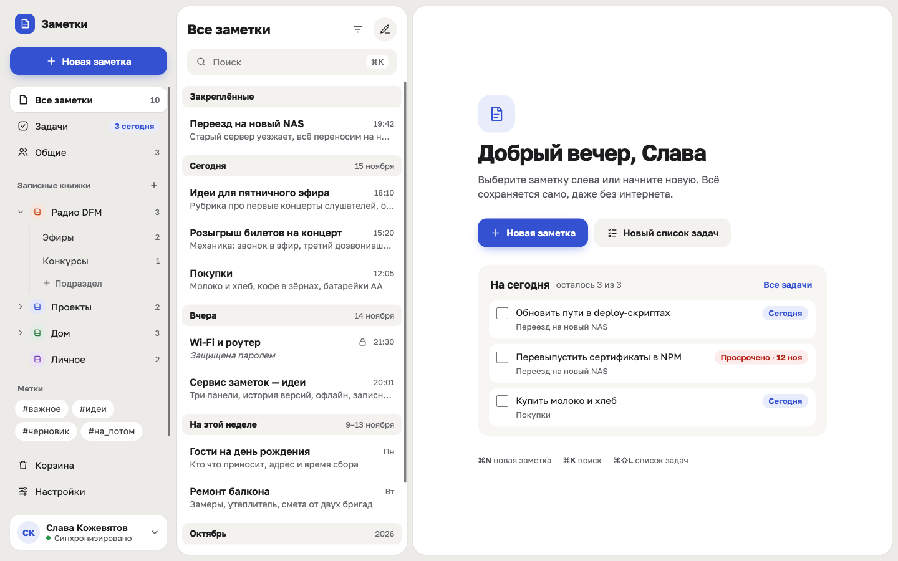
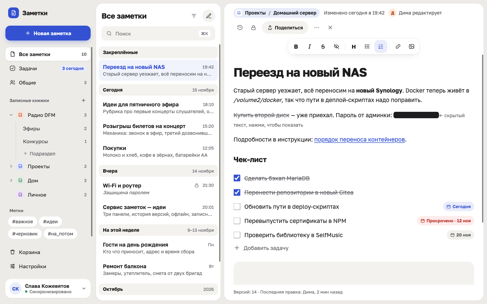

<div align="center">

# SelfNote

**Заметки и задачи на вашем собственном сервере.**
Работает без интернета, синхронизируется между устройствами, хранит историю каждой правки.

[](https://github.com/kozhevyatov/selfnote/actions/workflows/docker.yml)
[](https://github.com/kozhevyatov/selfnote/pkgs/container/selfnote)



</div>

## Зачем

SelfNote — замена облачным заметкам и Synology Note Station, которая живёт на вашем NAS или сервере в одном Docker-контейнере. Заметки принадлежат вам, а не сервису: база — SQLite или ваша MariaDB, картинки — обычные файлы в папке `data/`.

## Возможности

**Заметки**
- Записные книжки с подразделами и метки. Закрепление, корзина с автоочисткой через 30 дней.
- Простой редактор: жирный, курсив, зачёркнутый, **скрытый текст** (по клику), ссылки, заголовки, списки, картинки (вставка из буфера и перетаскиванием).
- Автосохранение — без кнопки «Сохранить».
- Мгновенный поиск по всем заметкам, в том числе без сети.

**Задачи**
- Чек-листы прямо в заметках, у каждого пункта — свой срок.
- Вкладка «Задачи»: сегодня, просрочено, предстоящие, без срока, выполненные.
- На главном экране — что нужно сделать сегодня, из всех заметок сразу.

**Надёжность**
- **Офлайн по-настоящему**: все заметки хранятся на устройстве, правки без сети догоняют сервер, как только он снова доступен. Конфликтов «чья версия главнее» нет — изменения сливаются (Yjs).
- **История версий** у каждой заметки: просмотр, подсветка изменений, восстановление одной кнопкой.
- Синхронизация в реальном времени между вкладками и устройствами.
- Пароли — Argon2id, короткоживущие токены, отзыв сессий, защита от перебора.
- Картинки: автоповорот, удаление EXIF (геометок), сжатие в WebP, превью.

**Дома на сервере**
- Один контейнер, мастер первого запуска: SQLite или существующая MariaDB, администратор, открытая/закрытая регистрация.
- Устанавливается как приложение (PWA) на телефон и компьютер.
- Сам разбирается с правами на папку данных на Synology.

<p align="center">
  
</p>

## Быстрый старт

Нужен Docker с Compose.

```bash
mkdir selfnote && cd selfnote
curl -O https://raw.githubusercontent.com/kozhevyatov/selfnote/main/docker-compose.yml
curl -o .env https://raw.githubusercontent.com/kozhevyatov/selfnote/main/env.example
mkdir data
docker compose up -d
```

Откройте `http://адрес-сервера:1339` и пройдите мастер первого запуска.

> **Совет.** Откройте сервис через домен с HTTPS (например, через Nginx Proxy Manager с включённым *Websockets Support*). Без HTTPS заметки работают, но браузер не даёт установить приложение и запускать его офлайн.

### Обновление

```bash
docker compose pull
docker compose up -d
```

Миграции базы выполняются сами при запуске. Данные в `data/` при обновлении не трогаются.

### Настройки (`.env`)

| Переменная | По умолчанию | Что делает |
|---|---|---|
| `PORT` | `1339` | Внешний порт на хосте |
| `APP_ORIGIN` | — | Полный адрес сервиса, например `https://notes.example.ru` |
| `COOKIE_SECURE` | `false` | `true`, если сервис открыт по HTTPS |
| `TRUST_PROXY` | `false` | `true`, только если сервис доступен исключительно через ваш reverse proxy |
| `PUID` / `PGID` | `1000` | От какого пользователя хоста работать (на Synology — ваш пользователь DSM, `id` по SSH) |
| `SELFNOTE_TAG` | `latest` | Версия образа: `latest`, номер релиза или `sha-…` |

**MariaDB в другой Docker-сети** (например, сеть `db` на Synology): раскомментируйте блоки `networks` в `docker-compose.yml` и укажите хост базы в мастере.

### Резервные копии

Всё состояние сервиса — папка `data/`: база SQLite (или настройки подключения к MariaDB), картинки, ключ токенов. Для копии SQLite остановите контейнер или используйте backup API; при MariaDB сохраняйте ещё и дамп базы. Автоматические бэкапы, экспорт и импорт (в том числе из Synology Note Station) — в ближайших планах.

## Планы

- [x] Фундамент: аккаунты, книжки и подразделы, редактор, задачи со сроками, картинки, офлайн-синхронизация
- [x] История версий и корзина
- [ ] Автоматические бэкапы, экспорт в Markdown, импорт из Synology Note Station и Markdown
- [ ] Повторяющиеся задачи, тёмная тема, перенос заметок перетаскиванием, серверный поиск
- [ ] Пароль на заметку (шифрование на устройстве)
- [ ] Публичные ссылки с паролем и сроком жизни
- [ ] Совместное редактирование: приглашения и гостевой доступ по ссылке с PIN
- [ ] Напоминания о сроках задач
- [ ] Мобильное приложение

## Технологии

React · TipTap · Yjs · IndexedDB · Hocuspocus · Fastify · Kysely (SQLite / MariaDB) · sharp · Vite PWA · TypeScript

## Для разработчиков

- [docs/development.md](docs/development.md) — локальный запуск, проверки, сборка образа из исходников, хранение данных.
- [docs/changelog.md](docs/changelog.md) — история изменений.
- [AGENTS.md](AGENTS.md) — полное техническое задание, архитектура и правила для ИИ-агентов.

Образ собирается и публикуется GitHub Actions при каждом push в `main`: сначала проверки типов, линтер, unit- и интеграционные тесты, затем сборка `ghcr.io/kozhevyatov/selfnote`.
